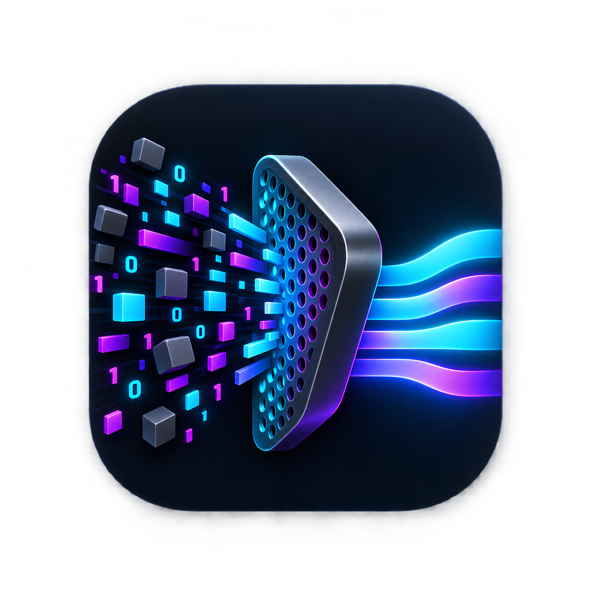

<p align="center">
  
</p>

<h1 align="center">Sift (<code>sf</code>)</h1>

<p align="center">
  <strong>Terminal macOS maintenance, app uninstaller, and disk space analyzer</strong>
</p>

<p align="center">
  <a href="https://github.com/SadeepaNHerath/Sift/releases/latest"></a>
  <a href="https://github.com/SadeepaNHerath/Sift/actions/workflows/test.yml"></a>
  <a href="https://github.com/SadeepaNHerath/homebrew-tap"></a>
  <a href="https://golang.org"></a>
  <a href="https://apple.com"></a>
  <a href="LICENSE"></a>
</p>

---

<p align="center">
  
</p>

---

**Sift (`sf`)** is an open source macOS maintenance, uninstallation, and disk analysis tool written in Go. It runs only on demand with no background daemons, no telemetry, and no subscriptions.

---

## Table of Contents

* [Why Sift?](#why-sift)
* [Feature Comparison](#feature-comparison)
* [Installation](#installation)
* [Quick Start Guide](#quick-start-guide)
* [Command Reference](#command-reference)
* [Safety Guarantees](#safety-guarantees)
* [Configuration Paths](#configuration-paths)
* [Development](#development)
* [License](#license)

---

## Why Sift?

Most Mac cleaners run background daemons, consume hundreds of megabytes of memory, send telemetry, and charge monthly subscriptions.

Sift is built differently:
* **Zero Background Daemons**: Runs only when called. Consumes 0 MB of idle memory.
* **Terminal First**: Run `sf` for an interactive terminal interface, or run individual commands with flags in scripts.
* **Safe Deletion**: Refuses to run under `sudo`, respects Apple System Integrity Protection (SIP) paths, supports dry run mode, and moves files to macOS Trash by default.
* **Developer Caches**: Cleans Xcode DerivedData, Docker containers and images, Homebrew caches, Gradle, and Cargo build artifacts.
* **Touch ID Support**: Uses macOS PAM so you can confirm elevated operations with Touch ID instead of typing passwords.
* **Base 10 Storage**: Matches macOS Finder and Disk Utility byte for byte (1 GB = 1,000,000,000 bytes) so disk numbers are always consistent.

---

## Feature Comparison

| Feature | Sift (`sf`) | CleanMyMac X | AppCleaner | DaisyDisk | iStat Menus |
| :--- | :---: | :---: | :---: | :---: | :---: |
| **Pricing** | **Free & Open Source** | $39.95/yr subscription | Free (Closed Source) | $9.99 one-time | $11.99 one-time |
| **License** | **MIT** | Proprietary | Proprietary | Proprietary | Proprietary |
| **Interface** | **Terminal TUI and CLI** | Cocoa / Electron GUI | Basic Cocoa GUI | GUI Treemap | Menu Bar GUI |
| **Idle Memory Footprint** | **0 MB (No Daemons)** | 400 MB+ (Background) | 0 MB | 0 MB | ~80 MB (Always-on) |
| **Telemetry & Privacy** | **Zero Telemetry (Offline)** | Analytics & Tracking | None | Analytics | Analytics |
| **App Uninstaller & Leftovers** | **Yes (Deep Container Scan)** | Yes | Yes (Basic Library) | No | No |
| **Disk Space Analyzer** | **Yes (Multithreaded)** | Basic | No | Yes (Visual Treemap) | Disk stats only |
| **Developer Artifacts Purge** | **Yes (Xcode, Docker, Brew)** | No | No | No | No |
| **Touch ID for Sudo** | **Yes (Native PAM helper)** | Password dialogs | Password dialogs | Password dialogs | Password dialogs |
| **Scriptable & CI Ready** | **Yes (UNIX pipes, stdout)** | No | No | No | No |
| **SIP and Non Root Protection** | **Strict SIP & Non Root Guard** | Helper daemon | Basic prompt | Read-only | Read-only |

---

## Installation

### Method 1: Homebrew (Recommended)

```bash
brew tap SadeepaNHerath/tap
brew install sf
```

### Method 2: Shell Installer

```bash
curl -fsSL https://raw.githubusercontent.com/SadeepaNHerath/Sift/main/install.sh | bash
```

### Method 3: From Source

Requires **Go 1.23+** and standard macOS command line tools:

```bash
git clone https://github.com/SadeepaNHerath/Sift.git
cd Sift
make all
make install
```

Verify your installation:

```bash
sf --version
```

---

## Quick Start Guide

### Interactive TUI Dashboard

Run `sf` without any arguments in your terminal to launch the interactive dashboard:

```bash
sf
```

The interactive menu displays live macOS metrics (hostname, OS build, architecture, disk usage) and provides keyboard shortcuts:
* `↑` / `k` : Move selection up
* `↓` / `j` : Move selection down
* `1` to `6` : Quick jump to shortcut command
* `↵ Enter` : Execute selected action
* `q` / `Esc` / `Ctrl+C` : Clean exit restoring terminal state

```text
   ____ ___ _____ _____ 
  / ___|_ _|  ___|_   _|
  \___ \ | || |_    | |  
   ___) || ||  _|   | |  
  |____/|___|_|     |_|  
  v2.2.0 • Terminal macOS maintenance toolkit

┌────────────────────────────────────────────────────────────────────────┐
│  Host: Mac.local │ OS: macOS 27.0 (arm64) │ Disk: 32.5 GB free / 245.1 GB (86.7% used) │ User: admin │
└────────────────────────────────────────────────────────────────────────┘

  Shortcut Commands:

 ❯ [1] 🧹 Clean      Clean system caches, app logs, and temporary files
   [2] 🗑️  Uninstall  Remove applications and associated leftover files
   [3] ⚡ Optimize   Rebuild caches, flush DNS, and run system optimizations
   [4] 📊 Analyze    Analyze disk space usage and locate large files
   [5] 🩺 Status     Check system health, disk metrics, and security overview
   [6] 🔥 Purge      Clean Xcode, Docker, Homebrew, and dev caches

  ↑/k Up  •  ↓/j Down  •  1-6 Quick Jump  •  ↵ Enter Launch  •  q/Esc Quit
```

> **Note**: When `sf` is invoked in a pipe or non-interactive environment (e.g. `sf | cat`), the interactive menu is bypassed automatically and standard CLI help is returned.

---

## Command Reference

| Command | Shortcut | Description |
| :--- | :---: | :--- |
| [`sf clean`](#sf-clean) | `1` | Scan and clean system, user, and application caches |
| [`sf uninstall`](#sf-uninstall) | `2` | Locate applications and remove associated leftover files |
| [`sf dedup`](#sf-dedup) | `3` | Find duplicates with APFS Copy on Write cloning and hardlinks |
| [`sf analyze`](#sf-analyze) | `4` | Multithreaded disk usage and large file analyzer |
| [`sf status`](#sf-status) | `5` | Overview of system storage, health, and security status |
| [`sf purge`](#sf-purge) | `6` | Clean developer build artifacts for Xcode, Docker, Homebrew, and Cargo |
| [`sf startup`](#sf-startup) | CLI | Manage launch agents, daemons, and background services |
| [`sf privacy`](#sf-privacy) | CLI | Clear clipboard history, recent items, and crash logs |
| [`sf optimize`](#sf-optimize) | CLI | Flush DNS cache, purge inactive memory, and update LaunchServices |
| [`sf installer`](#sf-installer) | CLI | Find and remove downloaded DMG and PKG installers |
| [`sf touchid`](#sf-touchid) | CLI | Configure Touch ID PAM authentication for terminal operations |
| [`sf doctor`](#sf-doctor) | CLI | Diagnose disk permissions, SIP status, and configuration health |
| [`sf history`](#sf-history) | CLI | View audit log of previous maintenance operations |
| [`sf update`](#sf-update) | CLI | Check for and apply updates from GitHub releases |
| [`sf completion`](#sf-completion) | CLI | Generate shell autocompletion scripts |

---

### Command Details

#### `sf clean`
Find and remove user caches, application logs, diagnostic reports, and temporary files.
```bash
sf clean                    # Interactive scan and cleanup
sf clean --dry-run          # Preview items to be cleaned without deleting
sf clean --all              # Clean all safe system and user cache targets
sf clean --user             # Target only ~/Library caches
```

#### `sf uninstall [app...]`
Uninstalls macOS application bundles and removes sandboxed containers, Application Support folders, preferences (`.plist`), and crash logs.
```bash
sf uninstall "Slack"
sf uninstall /Applications/Figma.app --dry-run
sf uninstall "Zoom" --trash # Move leftovers to Trash instead of permanent deletion
```

#### `sf dedup [paths...]`
Finds duplicate files using exact size matching, sparse hashing, and SHA-256. Supports **APFS Copy on Write cloning** (`clonefile`) to reclaim storage blocks immediately without breaking dependent applications.
```bash
sf dedup ~/Downloads                   # Interactive resolver with QuickLook
sf dedup ~/Documents --dry-run         # Preview duplicates without modifying files
sf dedup ~/Downloads --clone --yes     # Replace duplicates with APFS CoW clones
sf dedup ~/Projects --hardlink --yes   # Replace duplicates with filesystem hardlinks
sf dedup ~/Movies --keep-oldest -y     # Keep oldest file in each set and trash copies
sf dedup --min-size 10MB               # Scan files >= 10MB only
```

#### `sf optimize`
Runs macOS maintenance scripts, flushes local DNS cache, rebuilds LaunchServices, and frees purgeable memory.
```bash
sf optimize
sf optimize --dns           # Flush mDNSResponder cache only
sf optimize --ram           # Release inactive system memory
```

#### `sf analyze [path]`
Multithreaded directory scanner that calculates disk usage, identifies large files, and surfaces directory hogs.
```bash
sf analyze                  # Analyze root disk volume
sf analyze ~ --min-size 1GB # Show directories containing files > 1 GB
sf analyze /Users/Shared --depth 3
```

#### `sf status`
Shows system health diagnostics, disk usage matching macOS Finder, memory breakdown, thermal state, and SIP status.
```bash
sf status
sf status --json            # Output machine-readable JSON format
```

#### `sf purge`
Cleans developer build artifacts, package manager caches, and local AI model weights.
```bash
sf purge                    # Interactive selection of dev caches
sf purge --xcode            # Clear Xcode DerivedData, Archives, and iOS DeviceSupport
sf purge --docker           # Prune unused Docker images, containers, and build cache
sf purge --brew             # Clear Homebrew download caches and old formula versions
```

#### `sf installer`
Scans `~/Downloads` and cache directories for stale DMG disk images and PKG installers.
```bash
sf installer
sf installer --dry-run
```

#### `sf touchid`
Configures `/etc/pam.d/sudo` to allow Touch ID authentication for elevated terminal operations.
```bash
sf touchid --status         # Check current Touch ID PAM configuration
sf touchid --enable         # Safely configure Touch ID for sudo
```

#### `sf doctor`
Verifies Full Disk Access permissions, System Integrity Protection (SIP) status, terminal permissions, and broken symbolic links.
```bash
sf doctor
```

#### `sf history`
Reads the local SQLite audit ledger to display past cleanup operations and reclaimed storage.
```bash
sf history
sf history --limit 20
```

#### `sf completion [shell]`
Generate autocompletion scripts for your shell:
```bash
# zsh
sf completion zsh > ~/.zsh/completion/_sf

# bash
sf completion bash > /usr/local/etc/bash_completion.d/sf

# fish
sf completion fish > ~/.config/fish/completions/sf.fish
```

---

## Safety Guarantees

Sift is designed to prevent data loss and system corruption:

1. **Non Root Execution Guard**:
   Sift enforces an explicit check that refuses direct execution via `sudo sf`. Running cleaners directly as root can damage system permissions and delete user files. When elevated privileges are needed, Sift requests them scoped to the specific operation.

2. **System Integrity Protection (SIP) Compliance**:
   Sift respects Apple SIP boundaries. System directories (`/System`, `/usr/bin`, `/sbin`, `/Library/Apple`) are hard-coded into an immutable denylist and will never be touched.

3. **Dry Run Mode**:
   Destructive operations support `--dry-run` to preview all target files, paths, and byte sizes before any action is taken.

4. **Trash First Strategy**:
   By default, user files and applications are moved to the macOS Trash (`~/.Trash`) rather than permanently deleted, giving you a safe rollback window.

5. **Local Audit Log**:
   All deletions and system changes are recorded in a local SQLite database (`~/.local/share/sf/history.db`) with timestamps, exact paths, and byte counts.

---

## Configuration Paths

Sift adheres to standard XDG and macOS path conventions:

| Purpose | Path |
| :--- | :--- |
| **Configuration** | `~/.config/sf/config.toml` |
| **Audit Logs & History** | `~/.local/share/sf/history.db` |
| **Application Logs** | `~/Library/Logs/sf/` |
| **Temporary Cache** | `~/Library/Caches/sf/` |

---

## Development

Build and test Sift locally:

```bash
# Format code
make fmt

# Static analysis
make vet

# Run all tests with race detector
make test

# Build binary
make build

# Complete check & build
make all
```

---

## License

This project is licensed under the **MIT License**. See the [LICENSE](LICENSE) file for details.

Copyright © 2026 SadeepaNHerath. All rights reserved.
